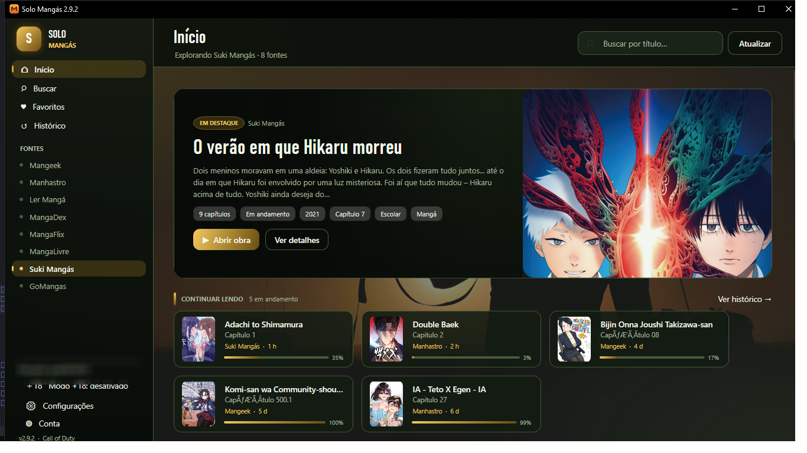

<div align="center">


# Solo Mangás

**Leitor nativo de mangás, manhwas e manhuas para Windows.**

[](#requisitos)
[](#requisitos)
[](#requisitos)
[](LICENSE)

[Download](#download) · [Recursos](#recursos) · [Fontes](#fontes) · [Atualizações](#atualizações-integradas) · [Compilar](#compilar-do-c%C3%B3digo-fonte) · [FAQ](docs/faq.md)



</div>

---

**Solo Mangás** é um leitor de mangás para Windows feito em **C# / .NET 8 / WPF**. É um executável único, portátil, sem instalador, sem WebView2 e sem anúncios dentro do app.

A conta Mangeek é a mesma do celular — moedas, favoritos, histórico e progresso sincronizados. As demais fontes mantêm favoritos, histórico e posição de leitura localmente.

## Download

A versão pronta fica na página de **[Releases](releases/latest)**.

| Edição | Arquivo | Tamanho | Requisito |
|---|---|---|---|
| Windows x64 | `Solo-Mangas-2.9.1.exe` | ~83 MB | Windows 10/11 x64 — nada para instalar |

> O executável é autocontido: não precisa de .NET, WebView2 nem runtime adicional.

**Verificar o hash (PowerShell):**

```powershell
Get-FileHash .\Solo-Mangas-2.9.1.exe -Algorithm SHA256
```

O hash e o tamanho de cada versão ficam na release e no `update.json`.

## Recursos

### Aparência
- Dois temas: **Call of Duty** (padrão da 2.8) e **Sangue & aço** (visual clássico).
- O tema Call of Duty usa uma foto real de fundo (UK MOD, OGL v1.0), paleta de
  carvão/oliva com dourado, tipografia Bahnschrift e painéis translúcidos.
- Troca em **Configurações → Aparência**; o app reinicia para aplicar.

### Catálogo e busca
- Seis fontes em português: **Mangeek**, **Manhastro**, **Ler Mangá**, **MangaDex**, **MangaFlix** e **MangaLivre**.
- Quatro fontes exclusivamente +18 liberadas com o modo adulto: **Hanami Heaven**, **HQ Brasa**, **Melhor Hentai** e **MangaDex +18**.
- Busca global consulta todas as fontes visíveis de uma vez e agrupa títulos repetidos; cada fonte aparece assim que responde.
- Fonte que falhou ou estourou o tempo é consultada de novo antes de ser marcada como sem resposta.
- Cache de resultados de busca por 2,5 minutos.
- Gêneros por fonte, catálogo paginado e destaques na tela inicial.

### Resiliência das fontes
- **MangaDex** espaça as requisições, respeita o `Retry-After` em 429 e repete até três vezes antes de mostrar erro.
- Catálogo e capítulos da MangaDex são somente em pt-br; nada de fallback para inglês.
- **Configurações → Fontes** tem *Testar* em cada fonte (status, tempo e obras) e *Testar todas* em paralelo.
- Mensagens de erro distinguem limite de requisições, serviço instável e falha de TLS/rede.

### Leitor
- Rolagem contínua (webtoon) ou página a página.
- Leitura contínua: emenda o próximo capítulo no fim do atual.
- Zoom por `Ctrl` + roda ou botões `A−` / `A+`.
- Tela cheia real (`F11`), com barra de tarefas e moldura escondidas.
- Barra de progresso, seletor de capítulos, capítulo anterior/próximo.
- Modo imersivo no leitor, com atalhos de teclado.

### Biblioteca
- Favoritos, histórico e posição de leitura por obra.
- Continuação de onde parou, inclusive entre capítulos.
- Backup dos dados em JSON e restauração pelo próprio app (**Importar backup**),
  com mescla de favoritos, histórico, lidos, posições e pesquisas.
- Ordem inicial dos capítulos configurável (último → 1º ou 1º → último).
- Modo +18 global com fontes adultas separadas.

### Desempenho
- Cada capa é baixada **uma única vez** e reaproveitada no destaque, nos cards, em favoritos e no "Continuar lendo".
- Imagens carregam só quando entram na tela, com cache em disco de até **1,2 GB** e limpeza automática dos arquivos mais antigos.
- Cache de capas em memória com limite de pixels e LRU.
- Conversão AVIF/HEIF em cache separado (Magick.NET).
- Download e decodificação com limites independentes: a rede não espera a CPU.

### Atualizações
- O app verifica, baixa e instala versões novas sozinho.
- SHA-256 conferido contra o manifesto `update.json`; hash diferente cancela a atualização.
- O executável é trocado por uma segunda instância (`--apply-update`) e o app reabre atualizado.
- Favoritos, histórico e configurações nunca são apagados.

## Fontes

| Fonte | Catálogo | Busca | Gêneros | +18 | Login |
|---|---|---|---|---|---|
| **Mangeek** | conta oficial | sim | ~48 tags | tags do catálogo | Google |
| **Manhastro** | API pública | sim | 46 gêneros | sim | não |
| **Ler Mangá Online** | WordPress | sim | do site | sim | não |
| **MangaDex** | API pública (PT-BR) | sim | traduzidos | sim | não |
| **MangaFlix** | SSR + API pública | sim | 54 categorias | sim | não |
| **MangaLivre** | WordPress + Slimeread | sim | 9 gêneros | sim | não |
| **Hanami Heaven** | Madara | sim | do site | só +18 | não |
| **HQ Brasa** | catálogo próprio | sim | do site | só +18 | não |
| **Melhor Hentai** | WordPress | sim | do site | só +18 | não |
| **MangaDex +18** | API pública | sim | traduzidos | só +18 | não |

Detalhes de cada adaptador em **[docs/fontes.md](docs/fontes.md)**.

## Atalhos

| Onde | Tecla | Ação |
|---|---|---|
| App | `Ctrl+F` / `Ctrl+K` | Abrir catálogo e focar a busca |
| App | `Ctrl+H` | Histórico |
| App | `Ctrl+,` | Configurações |
| App | `Alt+←` / botão lateral do mouse | Voltar |
| App | `F11` | Tela cheia |
| App | `Esc` | Sair da tela cheia |
| Leitor | `C` | Painel de capítulos |
| Leitor | `M` | Alternar webtoon / página a página |
| Leitor | `←` / `→` | Capítulo anterior / próximo (ou página, no modo página) |
| Leitor | `Espaço` / `PageDown` | Avançar |
| Leitor | `PageUp` | Voltar |
| Leitor | `Home` / `End` | Início / fim |
| Leitor | `Ctrl` + roda | Zoom |
| Leitor | `Esc` | Fechar painel / voltar |

## Onde ficam os dados

| Caminho | Conteúdo |
|---|---|
| `%APPDATA%\SoloMangas\store.json` | Favoritos, histórico, buscas, posições e configurações |
| `%APPDATA%\MangeekPC\session.json` | Sessão da conta Mangeek (preservada das versões anteriores) |
| `%LOCALAPPDATA%\SoloMangas\cache\img` | Cache de capas e páginas (até 1,2 GB) |

A pasta de dados pode ser aberta em **Configurações → Pasta de dados**. O backup em JSON fica em **Configurações → Backup dos dados**, e a restauração em **Configurações → Restaurar backup**.

## Atualizações integradas

A partir da 2.5.0 o app lê um manifesto `update.json` (ao lado do exe, numa pasta de rede ou numa URL), compara a versão e oferece **Baixar e instalar**. O download vai para `%TEMP%\SoloMangas-update`, o SHA-256 é conferido e o executável é substituído por uma segunda instância do próprio app.

Configuração em **Configurações → Atualizações → Origem das atualizações**:

- vazio — usa `update.json` ao lado do executável;
- pasta local/rede (`D:\SoloMangas`, `\\nas\solo`) — usa `<pasta>\update.json`;
- URL (`https://exemplo.com/solo`) — usa `https://exemplo.com/solo/update.json`.

O manifesto publicado nesta release está em **[update.json](https://github.com/flugel0706/solo-mangas/releases/latest/download/update.json)**. Guia completo em **[docs/atualizacoes.md](docs/atualizacoes.md)**.

## Login Mangeek

1. **Entrar com Google** abre o login numa janela do próprio app.
2. O redirecionamento para `geekstations.com.br/api/v1/oauth/google/callback` é interceptado antes de sair para a rede.
3. O `code` é trocado pelo JWT e a janela fecha sozinha.
4. A sessão fica em `%APPDATA%\MangeekPC\session.json`.

## Requisitos

- Windows 10 ou Windows 11, x64
- Para usar o executável: nada além do Windows
- Para compilar: [.NET SDK 8](https://dotnet.microsoft.com/download/dotnet/8.0) e Windows

## Compilar do código-fonte

```powershell
# Publicar o executável único autocontido
dotnet publish src/SoloMangas/SoloMangas.csproj -c Release -r win-x64 `
  --self-contained true -p:PublishSingleFile=true -o dist
```

Ou use o script pronto:

```powershell
.\scripts\build.ps1                 # publica em dist/
.\scripts\build.ps1 -SkipBuild      # só confere o executável já publicado
```

O resultado é `dist\SoloMangas.exe` (~83 MB, um arquivo). Instruções completas em **[docs/compilacao.md](docs/compilacao.md)**.

## Estrutura do projeto

```text
solo-mangas/
├─ src/
│  ├─ SoloMangas/            app WPF (.NET 8)
│  │  ├─ Program.cs          entrada e modo --apply-update
│  │  ├─ MainWindow.cs       shell, navegação, barra lateral, tela cheia
│  │  ├─ Pages/              Home, Catálogo, Obra, Leitor, Favoritos, Histórico, Login, Configurações
│  │  ├─ Sources/            adaptadores de cada fonte
│  │  ├─ ImageLoader.cs      download, decodificação e cache de imagens
│  │  ├─ UpdateService.cs    manifesto, download, SHA-256 e troca do exe
│  │  ├─ UpdateWindow.cs     janela "Atualizações — Solo Mangás"
│  │  ├─ LocalStore.cs       favoritos, histórico, posições e configurações
│  │  └─ ...
│  └─ Shared/                APIs Mangeek/Manhastro/Ler Mangá, HTTP, sessão e caminhos
├─ site/                     landing page (screenshots, update.json)
├─ docs/                     uso, fontes, atualizações, compilação, arquitetura e FAQ
├─ scripts/                  build e publicação no GitHub
└─ .github/workflows/        CI e release automática por tag
```

Mais detalhes em **[docs/arquitetura.md](docs/arquitetura.md)**.

## Aviso

O projeto não hospeda conteúdo: ele apenas exibe o que as APIs e os sites públicos das fontes servem. Nada de paywall ou assinatura é contornado — capítulos pagos continuam pagos. As obras exibidas pertencem aos seus autores e às fontes originais.

## Contribuindo

Leia **[CONTRIBUTING.md](CONTRIBUTING.md)**. Para vulnerabilidades, veja **[SECURITY.md](SECURITY.md)**.

## Licença

[MIT](LICENSE) © 2026 Solo Mangás
